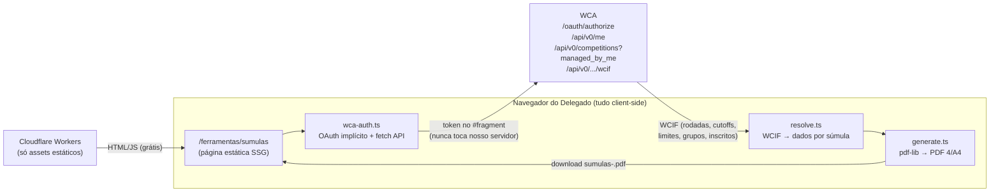

# CubingSP — Gerador de Súmulas WCA

Ferramenta em `/ferramentas/sumulas` que gera súmulas oficiais em PDF
(4 por folha A4, com guias de corte) para competições da WCA, no estilo
do Groupifier/AGE — porém com o layout oficial da CubingSP.

## Arquitetura

Decisão central: **tudo roda no navegador do delegado**. O nosso Worker
só serve a página estática; o token da WCA e os dados da competição
nunca passam pelo nosso servidor, e a geração de PDF não gasta nenhuma
requisição dinâmica — alinhado ao orçamento free-tier do site.



### Módulos (`src/modules/delegate-tools/`)

- `wca-auth.ts` — OAuth **implícito** (`response_type=token`, escopos
  `public manage_competitions`), token em `sessionStorage`; cliente da
  API v0 (`/me`, `/competitions?managed_by_me=true`, `/wcif`).
- `scorecards/types.ts` — subconjunto tipado do WCIF + tipos internos.
- `scorecards/format.ts` — centisegundos → `X:XX.XX`, nomes de eventos
  em PT, tentativas por formato, sanitização de nomes p/ WinAnsi.
- `scorecards/resolve.ts` — WCIF → dados de cada súmula: inscritos
  aceitos da rodada 1, grupos via `assignments` + atividades
  (`333-r1-g2`), rodadas 2+ como súmulas em branco, ordenação por
  grupo → nome.
- `scorecards/generate.ts` — pdf-lib; layout com cabeçalho
  [ID | Competição/Evento | Grupo], nome em contêiner de largura fixa
  (fonte encolhe até caber), textos dinâmicos e blocos de solves.
- `scorecards-tool.tsx` — máquina de estados da UI (login → permissão →
  competição → rodadas → PDF).

## Permissões (regra de acesso)

1. Login WCA obrigatório (OAuth implícito).
2. Após o login: `GET /me` + `GET /competitions?managed_by_me=true`.
   - Sem `delegate_status` **e** sem competições gerenciadas → tela de
     acesso restrito.
3. A lista de competições exibida é exatamente a `managed_by_me` (futuras
   + encerradas há ≤14 dias): é impossível gerar súmula de competição
   que o usuário não gerencia — o próprio WCIF exige essa permissão.

## Lógica dinâmica da súmula (conforme regulamento WCA)

| Caso | Bloco 1 | Texto intermediário | Bloco 2 |
|---|---|---|---|
| Ao5 (ex: 3x3x3) | Solves 1–2 | "Tempo de corte se > X" | Solves 3–5 |
| Mo3/Bo3 (6x6, 7x7, BLD 4/5) | Solve 1 | "Tempo de corte se > X" | Solves 2–3 |
| Sem cutoff (finais) | idem | "Não possui tempo de corte" | idem |
| Limite cumulativo (333bf, mbf) | — | texto do DNF vira "Tempo cumulativo de X" | — |

Sempre: cabeçalho com DNF/penalidade ("DNF se > X" · "Ex. Penalidade:
14.67 + 2 = 16.67"), bloco 3 = "Extra(s)" com E1/E2 e coluna extra **D**
para assinatura de Delegado. Colunas de cada linha: `# | S | tempo | J | C`.
FMC fica fora da lista (não usa súmula de tempo).

## Configuração (painel da WCA)

1. Acesse <https://www.worldcubeassociation.org/oauth/applications/new>
   (logado como Delegado/Organizador).
2. Crie um app com:
   - **Name**: CubingSP Súmulas
   - **Redirect URIs** (uma por linha):
     `https://SEU-SITE/ferramentas/sumulas`,
     `https://SEU-SITE/en/tools/scorecards`,
     `https://SEU-SITE/es/herramientas/sumulas`
   - **Scopes**: `public manage_competitions`
3. Copie o **Application UID (Client ID)** → variável
   `NEXT_PUBLIC_WCA_TOOL_CLIENT_ID` no Worker (Settings → Variables).
   *Não* há client secret: o fluxo implícito é público por design.
4. Dispare um redeploy (push ou Retry) para o build ler a variável.

## Teste local

```bash
npm run dev            # UI em http://localhost:3000/ferramentas/sumulas
npx tsx scripts/render-sample-scorecards.ts   # PDF de amostra com mocks
```

## Limitações conhecidas / roadmap

- Nomes com caracteres fora do WinAnsi (ex: CJK) caem para a parte
  latina do nome (fonte padrão do PDF). Roadmap: embutir fonte Unicode.
- Rodadas 2+ geram súmulas em branco (os classificados só existem no
  dia); quantidade configurável na UI.
- Competições sem grupos atribuídos no WCIF saem com o campo Grupo em
  branco (preenchível à mão). Roadmap: gerador de grupos próprio.
